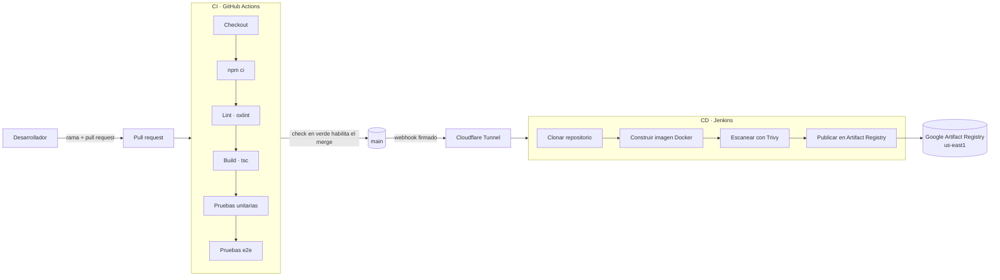
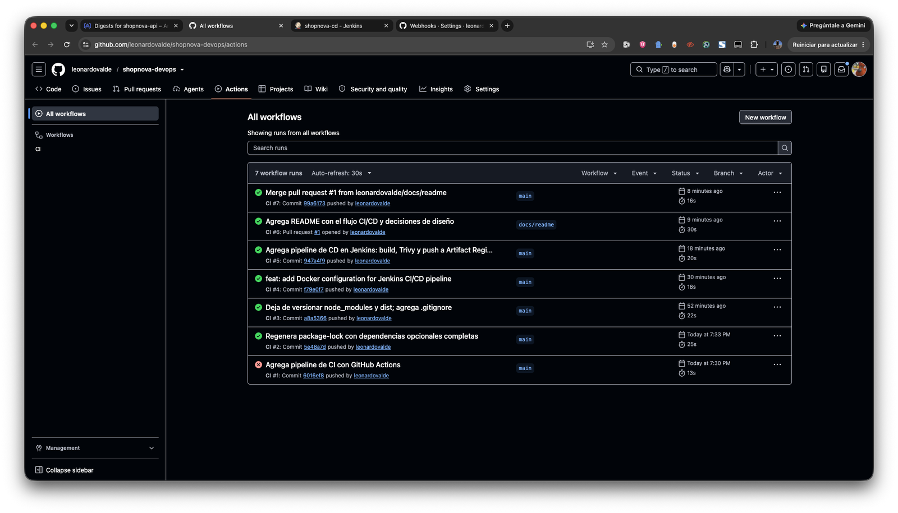
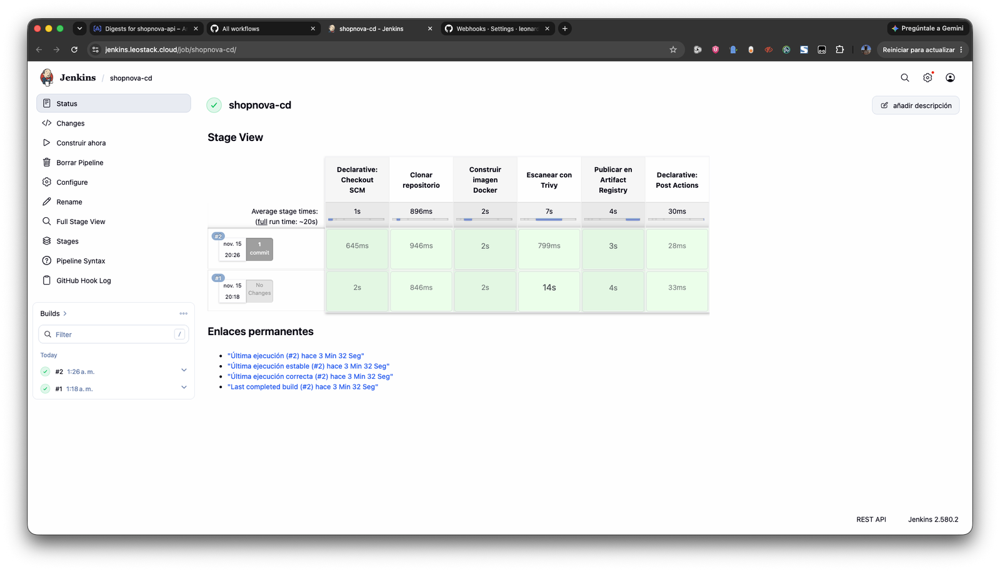
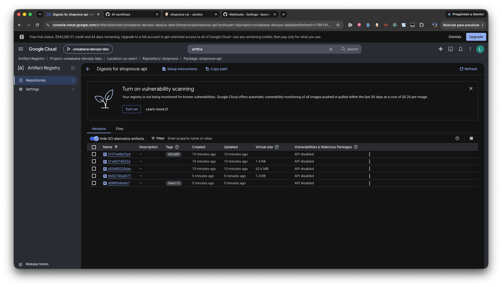
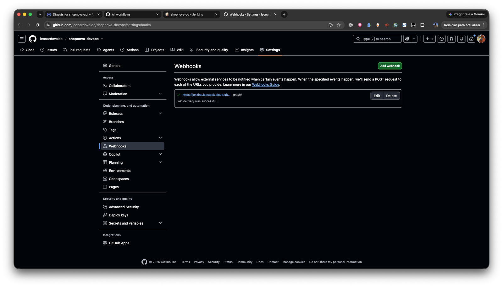
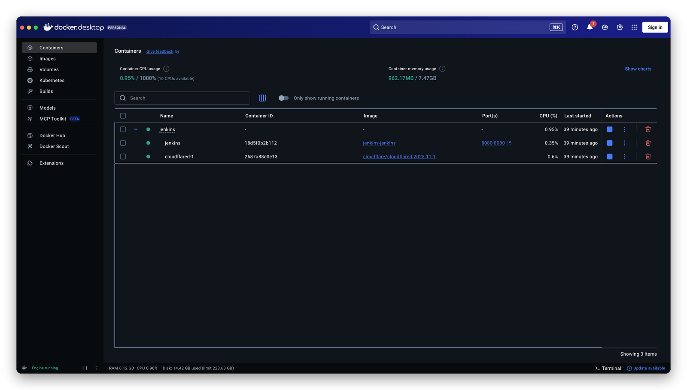
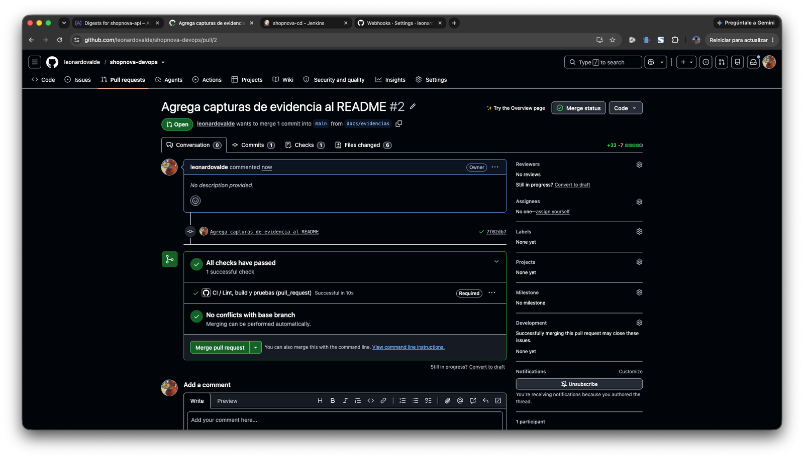

# ShopNova · Pipeline CI/CD

API de catálogo de **ShopNova**, un e-commerce mediano ficticio, con un pipeline de integración continua en **GitHub Actions** y uno de entrega continua en **Jenkins** que construye la imagen Docker, la escanea y la publica en **Google Artifact Registry**.

Proyecto del curso **Fundamentos de DevOps** (EFIN-FDVP20266), Maestría en Arquitectura de Software, Universidad de La Sabana. Corresponde a la fase 1 del proyecto (Unidad 2 · Actividad 3, laboratorio técnico) y aplica la arquitectura propuesta en la Actividad 2 de la misma unidad.

**Autor:** Jharvey Leonardo Valderrama Sepúlveda

---

## Arquitectura del flujo



- **CI** valida cada pull request. La rama `main` está protegida: solo se puede fusionar si el CI pasa en verde.
- **CD** se dispara con cada merge a `main`, de modo que Jenkins solo construye código que ya pasó el CI. La imagen se etiqueta con el hash del commit y solo llega al registro si Trivy no encuentra vulnerabilidades críticas.
- El despliegue en Kubernetes y el monitoreo corresponden a las fases 2 y 3 del proyecto.

---

## Flujo de trabajo

La rama `main` tiene un *ruleset* de GitHub que impide los push directos:

| Regla | Efecto |
|---|---|
| Pull request obligatorio | Todo cambio entra por una rama y un pull request |
| Status check requerido: **Lint, build y pruebas** | El botón de merge queda bloqueado hasta que el CI pasa en verde |
| Rama actualizada antes del merge | El CI se valida contra la última versión de `main` |
| Force push y borrado bloqueados | El historial de `main` no se puede reescribir |

```bash
git checkout -b feature/mi-cambio
# ...cambios...
git push -u origin feature/mi-cambio
gh pr create --fill          # corre el CI sobre el pull request
# con el check en verde → Merge → el webhook dispara Jenkins
```

Así el CI funciona como *quality gate*: el código que no pasa lint, compilación o pruebas no llega a `main` ni, por lo tanto, al registro de imágenes.

---

## La aplicación

API REST en **NestJS** (TypeScript, Node.js 24 LTS) con un catálogo de productos en memoria.

| Método | Ruta | Descripción |
|---|---|---|
| `GET` | `/productos` | Lista el catálogo |
| `GET` | `/productos/:id` | Consulta un producto |
| `POST` | `/productos` | Crea un producto |
| `PATCH` | `/productos/:id` | Actualiza un producto |
| `DELETE` | `/productos/:id` | Elimina un producto |
| `GET` | `/health` | Estado de la aplicación (se usará como *probe* de Kubernetes en la fase 2) |

### Ejecutar en local

```bash
npm ci
npm run start:dev          # http://localhost:3000
```

### Ejecutar con Docker

```bash
docker build -t shopnova-api:local .
docker run --rm -p 3000:3000 shopnova-api:local
curl http://localhost:3000/productos
```

---

## Pipeline de CI · GitHub Actions

Archivo: [`.github/workflows/ci.yml`](.github/workflows/ci.yml). Se ejecuta en cada `pull request` y en cada `push` hacia `main`.

| Stage | Comando | Para qué |
|---|---|---|
| Checkout | `actions/checkout@v4` | Obtiene el código del commit |
| Node.js 24 LTS | `actions/setup-node@v4` con caché de npm | Mismo runtime que la imagen de producción |
| Instalar dependencias | `npm ci` | Instalación reproducible a partir del `package-lock.json` |
| Análisis estático | `npm run lint` (oxlint con reglas de tipos) | Detecta errores y código sin uso antes de compilar |
| Compilar | `npm run build` | Verifica que el TypeScript compila |
| Pruebas unitarias | `npm test` (Vitest) | Valida la lógica del servicio de productos |
| Pruebas end-to-end | `npm run test:e2e` | Levanta la aplicación y prueba los endpoints HTTP |

---

## Pipeline de CD · Jenkins

Archivo: [`Jenkinsfile`](Jenkinsfile). Se dispara por webhook con cada merge a `main`.

| Stage | Qué hace |
|---|---|
| Clonar repositorio | `checkout scm` y obtiene el hash corto del commit, que se usa como tag de la imagen |
| Construir imagen Docker | `docker build --pull` con el [`Dockerfile`](Dockerfile) multi-stage |
| Escanear con Trivy | Primero reporta las vulnerabilidades HIGH y CRITICAL; después detiene el pipeline si hay alguna **CRITICAL** con parche disponible |
| Publicar en Artifact Registry | `docker login` con la llave de la cuenta de servicio y `docker push` a `us-east1-docker.pkg.dev/unisabana-devops-labs/shopnova/shopnova-api:<commit>` |

### Imagen Docker

El [`Dockerfile`](Dockerfile) usa dos etapas:

1. **builder** (`node:24-alpine`): instala todas las dependencias y compila TypeScript.
2. **production** (`node:24-alpine`): solo dependencias de producción y el código compilado (`dist/`), sin npm ni npx, ejecutado con el usuario sin privilegios `node`.

El [`.dockerignore`](.dockerignore) evita copiar `node_modules`, `dist`, `.git` y archivos de secretos al contexto de construcción.

---

## Infraestructura de Jenkins

Jenkins corre con **Docker Compose** ([`jenkins/`](jenkins/)) junto a un **Cloudflare Tunnel**, para que GitHub pueda entregar el webhook sin abrir puertos ni exponer una IP pública.

```
jenkins/
├── Dockerfile           # jenkins/jenkins:lts-jdk21 + Docker CLI + plugins
├── docker-compose.yml   # servicios jenkins y cloudflared
└── .env                 # token del túnel (no versionado)
```

```bash
cd jenkins
docker compose up -d --build
docker compose exec jenkins cat /var/jenkins_home/secrets/initialAdminPassword
```

---

## Herramientas y justificación

| Herramienta | Rol | Por qué se eligió |
|---|---|---|
| **GitHub** | Repositorio, pull requests y protección de rama | Requisito del laboratorio; integración nativa con GitHub Actions, webhooks y rulesets |
| **GitHub Actions** | CI | Vive junto al código, se define en YAML versionado y no requiere servidores propios; minutos ilimitados en repositorios públicos |
| **NestJS + TypeScript** | Aplicación | Estructura por módulos, controladores y servicios con inyección de dependencias; el tipado permite separar lint, build y pruebas como etapas |
| **oxlint** | Análisis estático | Linter incluido por el CLI de Nest; rápido y con reglas que usan la información de tipos |
| **Vitest** | Pruebas | Incluido por el CLI de Nest; ejecuta pruebas unitarias y e2e |
| **Docker** | Empaquetado | La misma imagen se ejecuta igual en cualquier ambiente (Turnbull, 2014) |
| **Jenkins** | CD | Requisito del laboratorio; control total sobre los stages de entrega y ejecución en infraestructura propia |
| **Trivy** | Escaneo de la imagen | Bloquea imágenes con vulnerabilidades críticas antes de que lleguen al registro; se ejecuta como contenedor con versión fija |
| **Google Artifact Registry** | Registro de imágenes | Registro privado con control de acceso por IAM y preparado para el clúster de GKE de la fase 2; se prefirió sobre Docker Hub por los permisos granulares |
| **Cloudflare Tunnel + Access** | Exposición de Jenkins | Permite recibir webhooks sin abrir puertos; la interfaz queda protegida con inicio de sesión |

---

## Seguridad

- **Ningún secreto en el repositorio.** La llave de la cuenta de servicio de GCP vive en *Jenkins Credentials* y el token del túnel en `jenkins/.env`; ambos están excluidos por `.gitignore`.
- **Cuenta de servicio con permiso mínimo.** `jenkins-ci` solo tiene el rol *Artifact Registry Writer* sobre el repositorio `shopnova`, no sobre el proyecto.
- **La llave no aparece en los logs.** El login usa `--password-stdin` dentro de `withCredentials`, y la sesión se cierra con `docker logout` al terminar.
- **Webhook firmado.** GitHub firma cada entrega con HMAC-SHA256 y Jenkins rechaza las que no traen la firma correcta.
- **Interfaz de Jenkins protegida.** Cloudflare Access exige inicio de sesión; solo la ruta `/github-webhook/` queda abierta para GitHub.
- **Imagen sin privilegios.** El contenedor de la aplicación corre con el usuario `node`, no como root.
- **Decisión consciente:** Jenkins monta el socket de Docker del host para construir imágenes. Es práctico para un laboratorio, pero quien controla Jenkins controla Docker en esa máquina; en producción se usarían agentes efímeros o herramientas como Kaniko.
- **Mejora identificada:** reemplazar la llave JSON por *Workload Identity Federation*, con el plugin OpenID Connect Provider de Jenkins, para eliminar credenciales de larga duración.

---

## Lo que detectó el pipeline

La primera ejecución del CI falló en `npm ci`: el `package-lock.json` generado en macOS no incluía dependencias opcionales (`@emnapi/core`, `@emnapi/runtime`) que el runner Linux sí necesitaba. Se regeneró el lock y el pipeline pasó en verde. Es un ejemplo de lo que busca la integración continua: el error apareció en minutos y en un ambiente limpio, no en producción.

El escaneo de Trivy en Jenkins reportó **6 vulnerabilidades HIGH** (0 CRITICAL, así que el *quality gate* no bloqueó). Al revisar el detalle, todas estaban en paquetes del npm que trae la imagen `node:24-alpine` (`brace-expansion` y `undici`, dentro de `/usr/local/lib/node_modules/npm`), no en las dependencias de la aplicación. Como la aplicación arranca con `node dist/main.js` y no necesita npm en tiempo de ejecución, el `Dockerfile` elimina npm, npx y corepack de la imagen final. Resultado: **0 vulnerabilidades HIGH o CRITICAL** y una imagen con menos herramientas disponibles para un atacante.

---

## Evidencias

### CI en GitHub Actions

Historial de ejecuciones del workflow `CI`. La primera falló por el `package-lock.json` incompleto (ver sección anterior); desde el arreglo, todas pasan, incluida la del pull request #1.



### Pipeline de CD en Jenkins

*Stage View* del job `shopnova-cd`. El build #1 se lanzó manualmente para registrar el job; el #2 lo disparó el webhook al fusionar el pull request #1 en `main`.



### Imagen publicada en Artifact Registry

Cada build publica una imagen etiquetada con el hash del commit (`947a4f9`, `99a6173`).



### Webhook de GitHub hacia Jenkins

El webhook apunta a `https://jenkins.leostack.cloud/github-webhook/` y su última entrega fue exitosa.



### Jenkins con Docker Compose

Los dos servicios del Compose en ejecución: `jenkins` y `cloudflared`.



### Protección de `main`: el CI como check requerido

Pull request #2: el check **CI / Lint, build y pruebas** aparece como *Required* y el botón de merge solo se habilita cuando pasa en verde.



---

## Referencias

- Kim, G., Humble, J., Debois, P., Willis, J. y Forsgren, N. (2022). *Manual de DevOps: Transformación exitosa de equipos, herramientas e infraestructura* (2.ª ed.). dpunkt.
- Turnbull, J. (2014). *The Docker book: Containerization is the new virtualization*. Turnbull Press.
- Documentación de [GitHub Actions](https://docs.github.com/actions), [Jenkins Pipeline](https://www.jenkins.io/doc/book/pipeline/), [Trivy](https://trivy.dev/) y [Artifact Registry](https://cloud.google.com/artifact-registry/docs).
